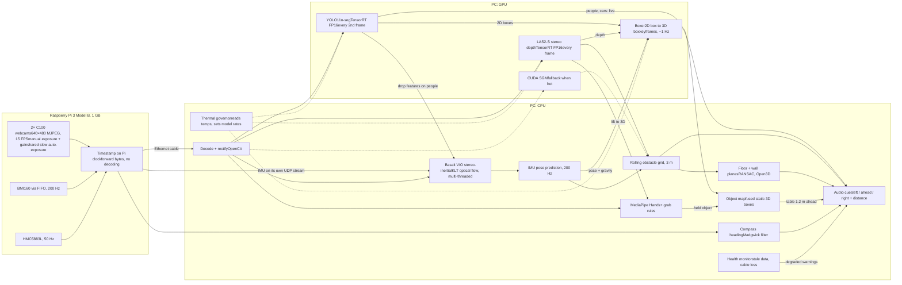
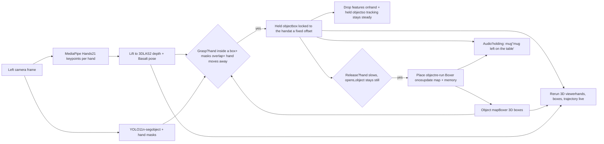
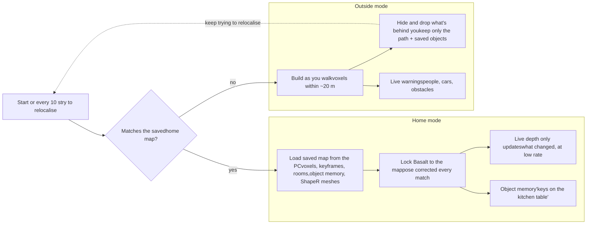

Gabai Lite · draft 9 · build plan · Ryzen 5 7500F + RTX 5060 Ti, two C100 webcams, wired

# An Aria-style Gabai that runs cool

Aria's approach, tuned for efficiency on your own consumer PC (Ryzen 5 7500F + RTX 5060 Ti 16 GB), brought to the competition and wired to the wearable. This draft is the plan to start coding from: every feature is kept, built in phases, and each phase has a pass/fail test before the next one starts. Tracking stays on the CPU like Aria's VIO chip. Vision models go to the GPU in small, fixed doses. Power limits and a thermal governor keep the PC cool and quiet.

**Hardware:** consumer PC with an AMD Ryzen 5 7500F (6 cores, 12 threads), 32 GB RAM and an NVIDIA RTX 5060 Ti 16 GB. Two EMEET C100 1080p webcams as a stereo pair, capped at 15 FPS (laggy, and very dark with auto-exposure off). Raspberry Pi 3 Model B (1 GB RAM), BMI160, and HMC5883L. **Link:** one Ethernet cable from the Pi straight to the PC (no Wi-Fi, no internet). All numbers on this page are estimates until Phase 1 measures them.

The split

**CPU:** Basalt stereo-inertial tracking, IMU prediction, the compass, and the obstacle logic. These are light, steady jobs, and that's also where Aria puts its tracking (no ML).

**GPU:** stereo depth with **Lite Any Stereo V2 (LAS2-S)** in TensorRT FP16, YOLO11n-seg, and **Boxer** once a second to turn YOLO boxes into metric 3D object boxes. GPU semi-global matching stays as a cheap fallback for when the box gets hot.

**Cool:** everything is capped at 15 FPS and rate-limited, the GPU clocks are locked below their maximum, and a governor drops model rates when a temperature limit is reached.

## Who does what

### CPU\~2–3 of 8+ cores

- MJPEG decode, grayscale, rectify (OpenCV)
- Basalt VIO stereo-inertial (KLT optical flow, the fastest open-source VIO in the comparisons below)
- IMU pose prediction at 200 Hz
- Compass heading: Madgwick filter on HMC5883L + BMI160
- MediaPipe Hands (21 keypoints per hand) + grab rules
- Rolling 3 m obstacle grid and audio cues
- Health monitor: stale frames, cable loss, slow models
- Thermal governor

### GPURTX 5060 Ti, \~3–4 GB of 16 GB

- Stereo depth: LAS2-S, ONNX exported to TensorRT FP16, at 640×480 (drop to 480×360 only if Phase 1 shows it can't keep up)
- Fallback depth: OpenCV CUDA `StereoSGM` when the governor says it's too hot
- YOLO11n-seg, TensorRT FP16, 416 px: people, cars, bikes, chairs, tables (or YOLOE with your own item names, see Object memory)
- Voxel map: LAS2 depth fused into 5 cm voxels (nvblox)
- Boxer on keyframes (about 1 Hz): YOLO boxes + LAS2 depth + pose + gravity become 3D boxes

## Gabai Lite pipeline



## Every part, checked

| Job | Library | Where | How often | Est. cost | Verdict |
| --- | --- | --- | --- | --- | --- |
| Capture + timestamp | Python, `v4l2` kernel frame timestamps, `smbus2`; sent over Ethernet | Pi 3B | 15 FPS / 200 Hz | light | Fits on the Pi |
| Calibration | `kalibr` | PC, once | offline | — | Runs |
| Camera tracking | `basalt` VIO (BSD-3) | CPU | every frame | \~5–10 ms on the 7500F | Runs live |
| Smooth pose | IMU propagation from the Basalt state | CPU | 200 Hz | \<1 ms | Runs live |
| Stereo depth | Lite Any Stereo V2, S model, ONNX → TensorRT FP16 (MIT) | GPU | every frame | \~10–20 ms at 640×480 (estimate) | Runs live |
| Fallback depth | OpenCV CUDA `StereoSGM` | GPU | when hot | a few ms | Runs live |
| People, cars, obstacles | YOLO11n-seg, TensorRT FP16 | GPU | every 2nd frame | \~2–4 ms | Runs live |
| 3D object boxes | Boxer (`facebookresearch/boxer`, CC-BY-NC) fed with YOLO boxes | GPU | 1 Hz, keyframes | \~30 ms per run (talk figure) | Runs, needs a small adapter |
| Fuse boxes over time | Boxer's own 3D box tracker (Hungarian matching) | CPU | \~1 Hz | light | Runs |
| Hand pose | MediaPipe Hands (Apache 2.0), 21 keypoints, lifted to 3D with LAS2 depth | CPU | every frame | \~10–15 ms | Runs live |
| Grab / release + held object | Rules from Lost & Found, own code | CPU | every frame | \<1 ms | Runs live |
| Live 3D view | Rerun (`rerun-sdk`, MIT/Apache) | CPU | 10–15 Hz | light | Runs live |
| Local obstacle map | NumPy grid | CPU | every frame | \~5 ms | Runs live |
| Floor and walls | RANSAC plane fitting (Open3D) | CPU | \~1 Hz | \~10 ms | Runs |
| Compass heading | `ahrs` (Madgwick / Mahony) | CPU | 50 Hz | \<1 ms | Runs live |
| Accurate 3D points | nvblox (NVIDIA, Apache 2.0) voxel fusion of filtered LAS2 depth; Open3D CUDA voxel grid as fallback | GPU | every 2nd frame | \~3–5 ms | Runs, check the build for your GPU |
| Clean up the home map once | `basalt_mapper` (Basalt's own offline map optimiser, global bundle adjustment) | CPU | once, after the mapping walk | minutes, offline | Runs |
| "Am I home?" relocalisation | DINOv2-small place search + ORB matching + PnP (OpenCV) | GPU + CPU | 1 Hz until found, then every 10 s | \~5–10 ms per try | Runs live |
| Object memory | YOLOE item names + Boxer box + DINOv2-small fingerprint, stored in SQLite | GPU + CPU | only on grab and put-down | a few ms per event | Runs live |
| Room layout as a "script" | SceneScript (research weights, you have it downloaded) | GPU | once per room, saved | 2–3 s; trained on Aria-style data | Experiment; RANSAC planes as backup |
| Object meshes | ShapeR (`facebookresearch/ShapeR`, \~1.2 GB weights, CC-BY-NC), `speed` preset | GPU | home objects only, when the PC is idle | seconds per object (guess, not published) | Runs in the background, needs an input adapter |
| Object memory, heavy version | Whareformer (DINOv2-g every frame) | GPU | — | too heavy | Leave out |

The costs are rough estimates scaled from published desktop numbers. I haven't measured anything on your card. The 5060 Ti is a Blackwell card (sm_120), so it needs PyTorch 2.7+ built for CUDA 12.8 and a recent TensorRT (10.8 or newer). Older pinned versions in some repos won't run on it.

## Load per frame at 15 FPS

A frame lasts about 66 ms. The CPU lane runs on several cores at once, so \~42 ms of work still leaves headroom. The CPU and the GPU work at the same time, so each lane only needs to fit in its own budget. Staying well under budget is what keeps the temperatures down.

### CPU lane\~42 ms of 66, spread over cores

Basalt VIO

\~10 ms

Decode + rectify

\~8 ms

MediaPipe Hands

\~12 ms

Grid + audio

\~5 ms

Feed GPU, health

\~7 ms

### GPU lane\~21 ms of 66

LAS2-S, 640×480

\~15 ms

YOLO (averaged)

\~2 ms

Boxer (1 Hz, averaged)

\~2 ms

Voxel map (averaged)

\~2 ms

The 5060 Ti sits mostly idle at this load, and that's the point: low load means low heat and quiet fans. If you want sharper depth, LAS2-M fits too.

Phase 3

## Grab an object, and the map follows

This copies ETH's **Lost & Found** (Marc Pollefeys' talk). They wore Aria glasses, picked objects up, and updated a 3D scene graph live as things moved. Aria supplies the 3D hand positions. Gabai Lite gets them from MediaPipe Hands plus LAS2 depth.



- **Grasp rule** (from Lost & Found): an interaction starts when the hand is inside or touching an object's box and then moves away with it. It ends when the hand slows down and the object stops moving.
- **While held**, the object keeps a fixed offset from the hand, so its box moves with your hand every frame. Lost & Found uses the same trick for translation.
- **Camera tracking doesn't move.** What updates live is the *object layer* of the map. The hand and held-object masks are removed from Basalt's features, so moving something in front of the camera doesn't fool the tracker into thinking you moved.
- **The 3D view** is for you as the developer (or a caregiver). Rerun is free and draws the hand skeleton, the moving box, the obstacle map and the path in real time. The blind user gets the audio line instead.

Aria-level alternatives for later: EgoForce (the DFKI talk) gives full 3D hand and forearm meshes from one camera, but runs at about 14 FPS on an RTX 3090 and its code release isn't confirmed. WiLoR is non-commercial. Either could run on the 5060 Ti as an optional high-quality mode, at the cost of more heat.

Phase 4

## Accurate 3D points

Raw stereo points from webcams are noisy, especially far away. With a 6 to 10 cm baseline at 640×480, depth is good to a few centimetres at 2 m but can be off by 20 cm or more at 5 m. These steps make the cloud clean without heavy models:

- **Keep only trusted pixels.** Drop pixels where left-to-right and right-to-left depth disagree, pixels on depth edges, and anything past about 4 m for the map (the obstacle warnings can still use farther points).
- **Remove moving things.** YOLO masks for people, hands and held objects are cut out before fusing, so they don't leave ghost trails.
- **Fuse many views into voxels.** nvblox averages every view of the same 5 cm cube on the GPU. One wall seen 50 times becomes one clean surface, not 50 noisy layers.
- **Fix drift with a saved map.** VIO slowly drifts. At home, the cleaned-up saved map pulls the pose back every time the relocaliser matches, so the points stay where they belong.

Phase 4

## Two map modes: home and outside

The PC decides the mode by itself: if the current view matches the saved home map, you're home. If nothing matches, it's outside mode. Everything is stored on the PC server, not on the Pi or the wearable.



### Make the home map once

Walk slowly through every room once. Basalt records keyframes and LAS2 depth. Then `basalt_mapper` optimises the whole map offline (loop closure, global bundle adjustment), and the PC saves the voxels, keyframes with their DINOv2-small and ORB features, and the room layouts.

Saved on the PC server, a few hundred MB for a house.

### Use it every day

On start, the PC compares the current frame with saved keyframes (DINOv2-small), matches ORB points, and solves the pose with PnP. Basalt then runs inside the saved map. Because the map already exists, map fusion drops to every 4th frame, so home mode runs cooler. Obstacle checks still run at full rate.

If furniture moves, those voxels are updated and saved back.

### Outside: build, then forget

Outside, points are fused only in a window of about 20 m around the user. Blocks behind you are hidden from the viewer and freed from GPU memory, so the cost stays flat however far you walk. Only the walked path and any object memories are kept.

Say "save this place" to turn a new place, like an office, into a second saved map.

Phase 5

## Object memory: "where did I put my keys?"

A light version of Whareformer that reuses the parts above. It only does work when you grab or put something down, not on every frame.

- **Your own items:** standard YOLO can't see keys, wallets or pill boxes. **YOLOE** (Ultralytics) takes a list of item names you type and still runs in TensorRT. It can replace YOLO11n-seg.
- **On put-down:** the grab rules fire a "placed" event. The PC saves the item name, its Boxer 3D box in home-map coordinates, the time, the surface it's on ("kitchen table"), and a DINOv2-small fingerprint to tell two similar mugs apart. All of it goes into a small SQLite file next to the home map.
- **On a question:** "where are my keys?" looks up the latest entry and speaks direction and distance from where you stand now: "kitchen table, 3 metres, slightly left".
- **Across days:** works because the home map is saved and relocalisation puts you back in the same coordinates. Outside, memory lasts for that walk only.

Phase 6

## ShapeR, the light way

ShapeR turns an object's points and a few photos into a 3D mesh. It's too slow for live use, so Lite runs it as a background job for home objects only.

- **Settings:** the `speed` preset (4 views, 10 steps) instead of `balance` (16 views, 25 steps). One object at a time.
- **When:** only while the user is still or Gabai is idle, and the GPU is under 65 °C. The governor pauses it the moment walking starts.
- **Input adapter you'll write:** ShapeR expects Aria-style pickles. Build them from the saved keyframes: 4 crops of the object with their poses, the voxel points inside its Boxer box, and the YOLOE item name as the caption. Open their `explore_data.ipynb` to copy the exact format.
- **Output:** a `.glb` mesh per object, saved with the home map and shown in Rerun. The live warnings still use boxes, which are faster and good enough.
- **Setup on the 5060 Ti:** PyTorch 2.7.1 with CUDA 12.8 matches your card. Expect to compile flash-attn and the legacy torchsparse yourself for sm_120.

## How Aria builds a map of tables, counters and cabinets

From your transcripts, this isn't one model. It's three steps that all share the SLAM coordinate frame. That shared frame is why the pieces line up so well.

### 1. SLAM gives the skeleton

VIO gives a metric pose for every frame, the gravity direction, and a semi-dense point cloud. Everything after this step uses the same coordinates.

Lite: Basalt poses + gravity from the BMI160, and LAS2 depth turned into points.

### 2. Boxes for every object

**Boxer** takes a 2D box (from OWLv2 or any detector), the image, the pose and the depth, and outputs a gravity-aligned, metric 3D box. A tracker merges the same object seen from many frames into one stable box.

Lite: the same, with YOLO boxes at 1 Hz.

### 3. Room shape and shapes

**SceneScript** reads the point cloud and writes walls, doors, windows and boxes as a short "script", which is then drawn as 3D. **ShapeR** generates a mesh inside each box from several posed images. In HD-EPIC, a Blender artist modelled the kitchen fixtures by hand from the point cloud.

Lite: SceneScript once per room (RANSAC planes as backup), and ShapeR meshes for home objects only, made in the background. Boxes stay the live layer.

ShapeR and SceneScript are both non-commercial research releases, and both were built around Aria data, so expect weaker results on webcam data until you test them.

## Keeping it from overheating

### Hard frame cap

Process at 15 FPS and drop extra frames. Never run "as fast as possible", because that pins the GPU at 100%.

### Lower the GPU power limit

Use `nvidia-smi -pl` to set a lower power limit (or MSI Afterburner on Windows), for example around 120 W instead of the stock limit. At this workload you won't lose speed, and the card runs much cooler.

### Cap the Ryzen

Turn on AMD **Eco Mode** (in the BIOS or Ryzen Master) so the 7500F runs at a lower power limit, or set the maximum processor state to about 80% in Windows. Give Basalt 3 to 4 threads. It parallelises well, which keeps each core cooler.

### FP16, small inputs

TensorRT FP16 engines and 320 to 416 px inputs. Half the pixels means roughly half the GPU work.

### Never slow the safety checks

Depth and the obstacle grid never drop below 7.5 Hz, even when you stand still, because a person or bike can still come at you. Only Boxer, ShapeR and map saving get slowed or paused.

### Thermal governor

A small loop reads temperatures every 2 seconds and lowers the model rates before the hardware throttles itself.

```
governor, every 2 s:
  GPU < 70 °C and CPU < 80 °C   →  LAS2 every frame, YOLO every 2nd frame, Boxer 1 Hz
  GPU 70–80 °C or CPU 80–90 °C  →  LAS2 every 2nd frame (7.5 Hz floor), YOLO every 4th, Boxer 0.3 Hz
  GPU > 80 °C or CPU > 90 °C    →  CUDA SGM instead of LAS2, Boxer off, say "reduced accuracy"
  any lane slower than 100 ms   →  same as hot, even if temperatures are fine
  ShapeR runs only when the user is still or not walking AND GPU < 65 °C, one object at a time
  Basalt and the IMU are never slowed down: tracking always comes first
```

Temperatures come from `nvidia-smi --query-gpu=temperature.gpu` and the CPU package sensor. The thresholds are starting points to tune on your box.

## Getting the most from the webcams and the Pi 3B

- **Why it goes dark with auto-exposure off:** the camera falls back to a short default exposure and low gain. Turning auto off only stops it adjusting. You have to set the exposure and gain yourself. Run `v4l2-ctl -d /dev/video0 --list-ctrls` to see the C100's real control names and ranges, because they vary by firmware.
- **Starting values:** set `auto_exposure` to manual, `exposure_time_absolute` to about 100–160 (10–16 ms, in 100 µs units), then raise `gain` until the image is bright enough. Brighten further with `gamma` or `brightness`, not longer exposure. Set `power_line_frequency` to your mains (50 or 60 Hz) to stop flicker. Turn off `backlight_compensation`.
- **Why it lags:** on most UVC webcams, auto-exposure in dim light quietly lowers the frame rate to get longer exposures. That shows up as lag. If the C100 has `exposure_dynamic_framerate`, turn it off. Manual exposure under 66 ms also keeps the full 15 FPS.
- **Stop old frames piling up:** on the Pi, use 2 capture buffers and always send the newest frame, dropping older ones. In OpenCV that's `CAP_PROP_BUFFERSIZE = 1`, then grab both cameras back to back before decoding either.
- **Our own slow auto-exposure:** a small loop on the Pi measures the average brightness of the left image once a second and nudges exposure and gain by small steps, applying *the same values to both cameras*. Slow, matched changes don't upset stereo matching or Basalt the way the camera's own fast auto-exposure does.
- **Brighten on the PC, not the camera:** apply CLAHE or a gamma curve to the images for YOLO and MediaPipe. Basalt and LAS2 work fine on darker, low-noise images, so give them the raw ones.
- **Lock white balance and focus** too, with `v4l2-ctl`, so colour and sharpness don't drift between frames.
- **Ethernet link:** one cable from the Pi to the PC with fixed IPs (for example 192.168.50.1 and .2), no router. Two 640×480 MJPEG streams need about 10–20 Mbps of the Pi's 100 Mbps. The Pi's Ethernet shares its internal USB 2.0 bus with the webcams, so don't add a third camera. Power the Pi and both webcams from a good 5 V 2.5 A power bank.
- **Request 640×480 MJPEG**, not 1080p. The Pi just forwards the compressed bytes without decoding, which keeps its CPU and 1 GB of RAM free. Use Raspberry Pi OS Lite (no desktop) so about 900 MB stays available.
- **Measure the camera-IMU time offset with Kalibr** and put it in Basalt's calibration file. Basalt doesn't estimate it while running, so your webcam lag has to be measured once and kept steady (fixed exposure, fixed 15 FPS, Pi timestamps).
- **Mount both cameras rigidly on one bar**, 6 to 10 cm apart, and keep exposure short so fast head turns don't blur.
- **Calibrate the HMC5883L for hard- and soft-iron errors** after it's mounted. Use it only for compass cues, not for tracking.

## Safety rules the code must follow

These come from the outside review, and they matter more than any model choice. Write them first and test them in every phase.

- **No depth is not clear space.** Grid cells with no trusted depth are "unknown", not "free". If the area straight ahead is mostly unknown, say "can't see ahead".
- **Stale data gets announced.** Every message carries its Pi capture time. If the newest frame is older than 300 ms, say "tracking delayed". If nothing arrives for 1 s, say "Gabai stopped, cable or camera lost" and repeat every 5 s.
- **One alert queue.** Only one module talks. Priority: 1 system failure, 2 moving person or vehicle approaching, 3 obstacle within 1 m, 4 obstacle 1–3 m, 5 object or hand info ("holding: mug"). A higher priority cuts off a lower one. The same alert isn't repeated within 3 s unless it gets closer.
- **Honest wording.** Round distances ("about 1 metre") and add "maybe" when confidence is low. In degraded mode, say "reduced accuracy" once.
- **The grid drives warnings, not labels.** An obstacle is warned about because space is occupied, even if YOLO doesn't know what it is. Labels only make the sentence nicer.
- **Supervised tests only.** Nobody relies on Gabai alone during testing or at the demo. Use a cane or a sighted helper, and keep away from traffic.

## Code layout to start from

Separate processes that talk over **ZeroMQ** on the PC, so a crash in one model doesn't kill tracking. Every message carries `t_capture` from the Pi's monotonic clock, which is the one clock for the whole system.

```
gabai/
  common/msgs.py        message types + msgpack encoding, t_capture on everything
  pi/capture.py         both C100s (v4l2, MJPEG, newest frame only), BMI160 FIFO 200 Hz,
                        HMC5883L 50 Hz, shared slow auto-exposure, send over Ethernet
  pc/receiver.py        receive, decode, rectify, publish Frame + Imu
  pc/vio/               Basalt (C++) live wrapper, publishes Pose 15 Hz + predicted 200 Hz
  pc/depth.py           LAS2-S TensorRT, left-right check, publishes Depth + confidence
  pc/detect.py          YOLO11n-seg (later YOLOE) TensorRT, publishes Dets + masks
  pc/hands.py           MediaPipe Hands, lift keypoints with Depth + Pose, publishes Hands3D
  pc/grab.py            grasp / release rules, held object, publishes ObjectEvents
  pc/boxer_worker.py    Boxer at 1 Hz on keyframes, 3D box tracker, publishes Objects3D
  pc/grid.py            rolling 3 m grid: free / occupied / unknown, publishes Hazards
  pc/alerts.py          the one alert queue + text-to-speech (offline, e.g. Piper)
  pc/health.py          stale data, cable loss, slow lanes, sends system alerts
  pc/governor.py        temperatures + lane times, sets model rates
  pc/viewer.py          Rerun: cameras, depth, hands, boxes, grid, path
  tools/                stopwatch sync test, depth error test, latency logger
  later/                map/ (nvblox, home map, relocaliser), memory/, shaper/, scenescript/
```

```
message types (all carry t_capture):
  Frame      left, right (gray, rectified), exposure, gain
  Imu        gyro[3], accel[3]
  Pose       T_world_cam (4×4), gravity, quality 0–1
  Depth      depth (m), confidence, pose used
  Dets       class, score, box, mask (low-res)
  Hands3D    per hand: 21 keypoints in world frame, open/closed score
  Objects3D  id, class, 3D box, held_by (none / left / right)
  Hazard     direction, distance, size, moving yes/no, confidence
  Alert      priority 1–5, text, expires_at
```

For the Basalt live wrapper, look at the Monado project's Basalt fork, which already feeds Basalt from live cameras for XR headsets. Use it as a reference before writing your own.

## Build plan: phases with pass/fail tests

Every feature stays. Each phase starts only after the one before passes its test. The thresholds are starting targets you can adjust; the point is that you measure them. The core for the competition is Phases 1 and 2. Hands and grabbing are Phase 3, and they're in the demo if Phase 3 passes in time.

| Phase | Build | Pass when |
| --- | --- | --- |
| 1a | Pi capture over Ethernet, rigid mount, manual exposure, Kalibr calibration including the camera-IMU time offset | Stopwatch test: left and right frames show the same time within 10 ms, walking and still. Delay from Pi capture to PC under 50 ms. No dropped frames in 10 minutes. |
| 1b | LAS2-S TensorRT next to CUDA SGM, depth error test | LAS2-S under 25 ms on the 5060 Ti at 640×480. Distance error under 5% at 1 m and 2 m, and under 10% at 3 m, on a wall, a chair, a dark bag and a thin pole. |
| 1c | Basalt live | A 30 m indoor walking loop ends within 0.5 m of the start. No lost tracking on normal head turns. Standing still for 60 s drifts under 5 cm. |
| 2a | Rolling grid (free / occupied / unknown) + YOLO masks for people | A wall seen again after a loop lines up within 10 cm. A person walking past leaves no obstacle behind after 2 s. A box on the floor is detected at 1 m and 2 m. |
| 2b | Alert queue, offline speech, health monitor, governor | Obstacle appears to spoken word under 400 ms (95th percentile). Unplugging the cable is announced within 1 s. A 30-minute run stays under 75 °C on the GPU with no lane over 100 ms. |
| 2c | Supervised course test: hallway, chairs, a person crossing | All placed obstacles warned before 1 m in 10 out of 10 runs, no missed person, at most 1 false alarm per run. |
| 3 | MediaPipe Hands, 3D lift, grab and release rules, held object box, Boxer at 1 Hz, Rerun view | Hand keypoints within 3 cm at arm's length. 9 out of 10 real pick-ups detected, at most 1 false grab in 5 minutes of normal hand movement. Tracking doesn't jump while holding something in front of the cameras. |
| 4 | Voxel map with nvblox, outdoor rolling window, home map + relocaliser | Relocalises at home in under 5 s from 5 different start spots, with lights on and off. Outdoor GPU memory stays flat over a 15-minute walk. |
| 5 | Object memory with YOLOE, SQLite, "where are my keys?" | 8 out of 10 placed items found within 30 cm after walking away and coming back. |
| 6 | SceneScript per room, ShapeR in the background | Runs only when idle and never raises a lane over 100 ms during walking. |

If Phase 1a fails because the two webcams can't stay in sync, buy a synchronized stereo USB camera before writing more software. Everything after it depends on that.

## Sources

- Aria talks you shared (Jakob Engel: no ML in SLAM, stereo+IMU first; Michael Goesele: OpenCV SGBM as the simple depth option; James Fort: VIO front end design).
- [HybVIO paper](https://arxiv.org/pdf/2106.11857), Table B1: Basalt 5 ms per frame vs ORB-SLAM3 56 ms on a Ryzen 9 3900X.
- [Monado SLAM dataset](https://arxiv.org/pdf/2508.00088) (XR headsets, egocentric): Basalt fastest and second most accurate; OpenVINS couldn't run with reasonable accuracy there.
- [LaMAria benchmark](https://arxiv.org/pdf/2509.26639): OpenVINS best open-source system on Aria data; Basalt not tested.
- [Lite Any Stereo V2](https://arxiv.org/html/2606.24457v1) and [its code](https://github.com/TomTomTommi/LiteAnyStereo) (MIT, ONNX export). On Orin NX: LAS2-S 81 ms vs Fast-FoundationStereo 918 ms.
- [Boxer repository](https://github.com/facebookresearch/boxer) (inputs, OWLv2 detector, 3D box tracker, CC-BY-NC). Talks by Daniel DeTone and Jakob Engel on Boxer, SceneScript and ShapeR.
- [Lost & Found](https://arxiv.org/html/2411.19162) (ETH: grasp rules, fixed hand-object offset, scene graph updates) and [EgoForce](https://arxiv.org/pdf/2605.12498) (14 FPS on an RTX 3090).
- [SceneScript](https://www.projectaria.com/scenescript/) (research weights, 2–3 s per scene) and [ShapeR](https://github.com/facebookresearch/ShapeR) (code and Hugging Face weights released; needs PyTorch 2.7.1 cu128, flash-attn and legacy torchsparse).
- [nvblox](https://github.com/nvidia-isaac/nvblox) (GPU voxel mapping) and Basalt's [visual-inertial mapping paper](https://arxiv.org/abs/1904.06504) (`basalt_mapper`).
- RTX 5060 Ti version: [Gabai Aria Pipeline](https://claude.ai/artifact/EBkkzFv8cHEuErpMdTyUMC).